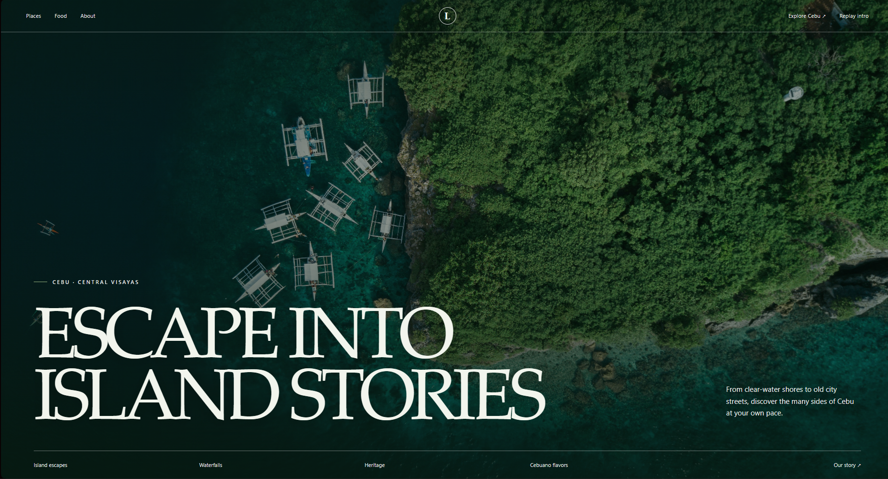
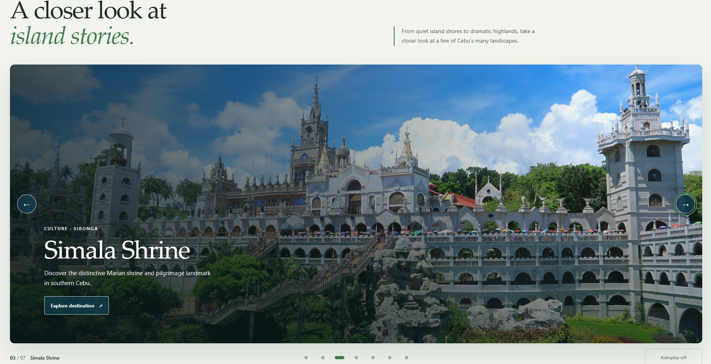
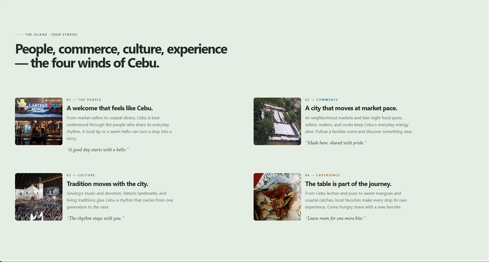

# 🏝️ LipadCebu

A beautiful, responsive travel and tourism website for **Cebu, Philippines** — showcasing the island's best destinations, food, culture, and heritage, with an integrated booking system for your Cebu adventure.


*Homepage featuring Cebu's stunning landscapes and island stories.*

---

## 📖 Overview

**LipadCebu** ("Lipad" means "to fly" in Cebuano) is a full-stack travel website designed to help travelers discover and explore Cebu. It combines a React-powered frontend with an ASP.NET Core MVC backend, offering:

- An immersive homepage with featured destinations, stories, and a food guide
- A browsable catalog of tourist spots with filtering by experience type
- A booking form for reservations with confirmation pages
- Google Maps integration for directions to each destination
- Photo credits and licensing for all imagery

Built with **.NET 10**, **React 19**, and **Vite**, the site delivers a smooth, modern experience with responsive design, smooth scroll animations, and an accessible interface.

---

## 🖼️ Screenshot






---

## ✨ Features

### 🏝️ Destination Discovery
- **Featured Places Slideshow** — Auto-playing carousel of top Cebu attractions with navigation arrows and pagination dots
- **Destination Grid** — 18+ tourist spots including beaches, islands, waterfalls, heritage sites, and mountains
- **Experience Filters** — Filter destinations by category: Islands, Waterfalls, Mountain views, Nature, Adventure, Heritage
- **Destination Dialogs** — Click any card to view detailed info, fun facts, location, and Google Maps link
- **Reveal-on-Scroll Animations** — Elements animate into view as you scroll

### 🍽️ Cebuano Food Guide
- **Food Cards** — 9 must-try Cebuano dishes with descriptions, where to find them, and map links: Cebu Lechon, Puso (Hanging Rice), Ngohiong, Tuslob Buwa, Sutukil, Danggit, Dried Mangoes, Otap, Rosquillos
- **City Food Crawl** — Suggested food crawl route with Google Maps directions

### 📖 Island Stories
- **Four Stories Section** — People, Commerce, Culture, and Experience — each with imagery, quotes, and descriptions
- **Intro Overlay** — First-visit welcome dialog with featured destination previews

### 🏨 Booking System
- **Booking Form** — Reserve rooms with guest details, room type, check-in/check-out dates, and special requests
- **Confirmation Page** — Booking summary with ID, guest info, dates, room type, and total price in Philippine Pesos (₱)
- **Server-side Processing** — ASP.NET Core controller handles form submission and stores booking data

### 🎨 Design & UX
- **Responsive Layout** — Mobile-first design with breakpoints for tablets and desktops
- **Tropical Color Palette** — Deep ocean, tropical teal, sea glass, warm sand, and sunset coral accents
- **Smooth Scrolling** — Anchor links with scroll-behavior and scroll-padding
- **Skip to Content** — Accessibility link for keyboard navigation
- **Reduced Motion Support** — Respects `prefers-reduced-motion` for accessibility
- **Lazy Loading** — Images load efficiently with `loading="lazy"` and fetch priorities

### 📸 Photo Credits
- Full attribution for all photos in the footer, including Wikimedia Commons sources with CC0, CC BY, CC BY-SA, and CC BY 2.0 licenses

---

## 🏗️ Project Structure

```
lipadcebu2/
├── Program.cs                  # ASP.NET Core application entry point & middleware config
├── lipadcebu2.csproj           # .NET 10 project file with React build integration
├── appsettings.json            # Application configuration
├── Controllers/
│   ├── HomeController.cs       # Homepage, Choices, Confirmation actions
│   └── BookingController.cs    # GET/POST Booking, Paying actions
├── Models/
│   └── Bookingforminputs.cs    # Booking data model (guest info, dates, price, etc.)
├── Views/
│   ├── Home/
│   │   ├── Homepage.cshtml     # React mount point + homepage stylesheet
│   │   ├── Choices.cshtml      # Destination selection page
│   │   └── Confirmation.cshtml # Booking confirmation page
│   ├── Booking/
│   │   └── Booking.cshtml      # Booking reservation form
│   └── Shared/
│       └── _layout.cshtml      # Shared HTML layout with meta tags
├── ClientApp/                  # React frontend (Vite)
│   ├── package.json            # React 19 + Vite dependencies
│   ├── vite.config.js          # Vite build configuration
│   └── src/
│       └── main.jsx            # React app: destinations, foods, stories, components
├── wwwroot/
│   ├── dist/
│   │   └── app.js              # Built React bundle
│   ├── css/
│   │   ├── HomepageStyle.css   # Main stylesheet (~4,000 lines)
│   │   ├── BookingStyle.css    # Booking form styles
│   │   └── ChoicesStyle.css    # Choices page styles
│   ├── app.js                  # Legacy app.js
│   ├── favicon.ico
│   ├── source-photos/
│   │   ├── Tourist-Spots/      # 30+ destination photos
│   │   ├── Food/               # 9 Cebuano food photos
│   │   └── Backgrounds/        # Page background images
│   └── tspots-Cebu/            # Additional Unsplash attribution photos
└── README.md
```

---

## 🔑 Key Parts of the Project

| Component | Purpose |
|-----------|---------|
| **Program.cs** | Configures the ASP.NET Core pipeline: MVC, static files, HTTPS redirection, routing, and the default route (Home/Homepage) |
| **HomeController.cs** | Serves the main pages: Homepage, Choices, and Confirmation |
| **BookingController.cs** | Handles booking form GET (display) and POST (submit + save booking), redirects to confirmation |
| **Bookingforminputs.cs** | C# model for booking data: guest name, email, phone, room type, dates, special requests, total price |
| **ClientApp/src/main.jsx** | The entire React application: all destination/food/story data, components, filters, and view transitions |
| **HomepageStyle.css** | Comprehensive styling: CSS variables, hero section, slideshow, destination grid, food grid, stories, about section, footer, and responsive media queries |
| **BookingStyle.css / ChoicesStyle.css** | Page-specific styles for the booking form and destination choices page |
| **_layout.cshtml** | Shared Razor layout with viewport meta, description, and title from ViewData |
| **Homepage.cshtml** | Razor view that mounts the React app into #react-root and loads the built dist/app.js |

---

## 🚀 Getting Started

### Prerequisites
- .NET 10 SDK or later
- Node.js (for the React/Vite frontend)

### Running the Application

1. **Clone the repository**
   ```bash
   git clone https://github.com/15-hrs/LipadCebu.git
   cd LipadCebu
   ```

2. **Build and run with .NET**
   ```bash
   dotnet build
   dotnet run
   ```

   The .csproj file automatically runs `npm run build` in the ClientApp folder before building, which compiles the React frontend with Vite.

3. **Open your browser**
   Navigate to `https://localhost:5001` (or the URL shown in the terminal).

### Frontend-Only Development

If you want to work on just the React frontend:
```bash
cd ClientApp
npm install
npm run build
```

---

## 🛠️ Tech Stack

| Layer | Technology |
|-------|-----------|
| **Backend** | ASP.NET Core MVC (.NET 10, C#) |
| **Frontend** | React 19, React DOM |
| **Build Tool** | Vite |
| **Styling** | CSS3 (custom properties, Grid, Flexbox) |
| **Views** | Razor (.cshtml) |
| **Data Model** | C# classes (Booking model) |
| **Maps** | Google Maps (embedded links) |
| **Images** | Local assets + Wikimedia Commons (CC licensed) |

---

## 📄 License

This project is provided as-is. Photo credits and licenses are listed in the website footer and in ClientApp/src/main.jsx (imageCredits array). Most images are sourced from Wikimedia Commons under CC0, CC BY, CC BY-SA 4.0, and CC BY 2.0 licenses.

---

## 👥 Credits

Created by **IVM.Tools** — see the site footer for details.

*Made for curious hearts. ✈️ Lipad Cebu*
